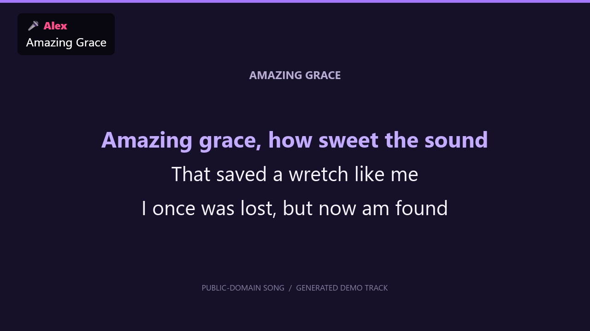
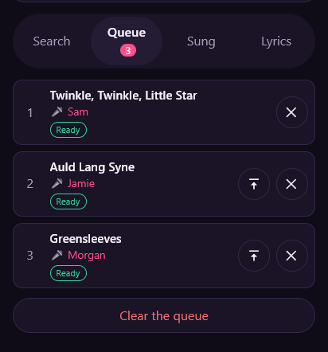

# Karaoke

[](LICENSE)

Karaoke on your TV, controlled from your phone. Run the server on one computer,
scan the QR code, and start queuing songs. No accounts or API keys.

| TV player | Phone queue |
| --- | --- |
| [](docs/images/tv-player.png) | [](docs/images/phone-remote.png) |

*Screenshots use sample singers and a generated demo track.*

## Features

- **Songs:** YouTube search, local videos, audio and MP3+G.
- **Shared queue:** add your name, sing next, reorder, skip and control playback.
- **TV view:** fullscreen playback, singer names, up-next cards and optional lyrics.
- **Key changes:** up or down six semitones, at the same tempo.
- **[Mic effects](FEATURES.MD):** boost, echo, reverb, voice doubling and auto-tune.
  Linux desktops can use PipeWire for low latency.
- **Portable:** one binary for Linux, macOS and Windows, or Docker.

## Run

Get the source:

```sh
git clone https://github.com/vantuan5644/karaoke.git
cd karaoke
```

Run with **Go 1.26+**:

```sh
go run . -open
```

For YouTube downloads, install **yt-dlp**, **ffmpeg** and **deno**.

Or use **Docker**, which includes those tools:

```sh
docker compose up -d
```

For Docker's phone QR code, set `-public-url http://YOUR-LAN-IP:8765`
in [compose.yaml](compose.yaml).

## Use

1. Open **http://localhost:8765/tv** on the computer connected to the TV and click **Start**.
2. On the same network, scan the TV's QR code with your phone.
3. Search for a song, enter your name and add it to the queue.

On the TV: **F** fullscreen · **/** search · **L** lyrics · **V** microphone settings.
Browser microphones need localhost or HTTPS.

For your own files, run `go run . -open -library /path/to/songs`.
Use the app on a trusted home network or VPN.

---

© 2026 Tuan Tran and contributors · [CC BY-NC 4.0](LICENSE) ·
[Third-party notices](THIRD_PARTY.md) · [Contributing](CONTRIBUTING.md)
